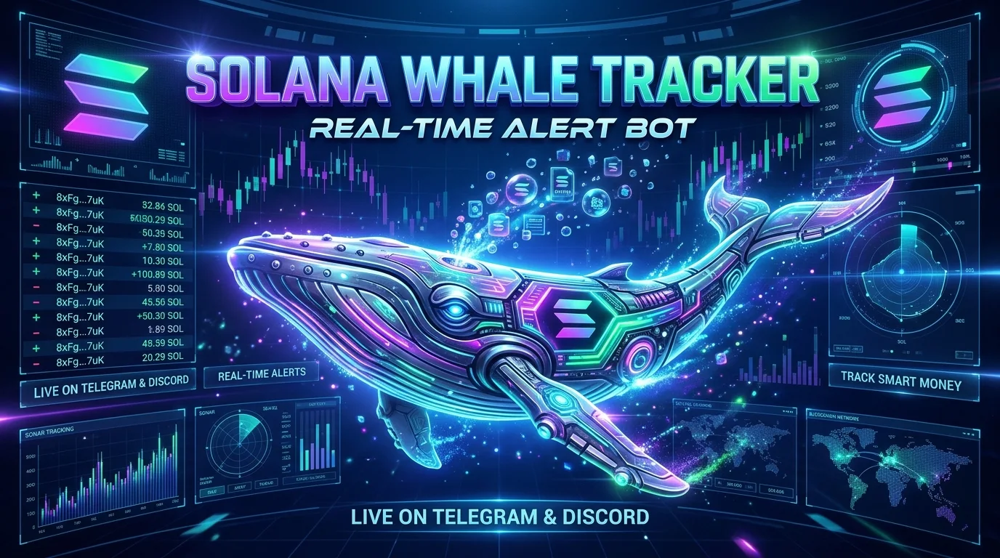

<div align="center">

# 🐋 ربات ردیاب نهنگ‌های سولانا (Solana Whale Tracker Bot)



[](https://t.me/Sa_whale_bot)
[](https://www.typescriptlang.org/)
[](https://fastify.dev/)
[](https://solana.com/)

[🇬🇧 English](./README.md) | **🇮🇷 فارسی**

</div>

<div dir="rtl">

یک ربات پرسرعت و لحظه‌ای برای **ردیابی نهنگ‌ها و پول هوشمند (Smart Money) روی شبکه اصلی سولانا** که با TypeScript، فریم‌ورک Fastify و وب‌هوک‌های پیشرفته Helius ساخته شده است. این سرویس کیف‌پول‌های برچسب‌گذاری‌شده را برای تراکنش‌های `SWAP` به‌صورت زنده رصد می‌کند، توکن‌های مشکوک را با بررسی‌های امنیتی درون‌زنجیره‌ای و RugCheck فیلتر می‌کند و هشدارهای فوری را به تلگرام می‌فرستد.

👉 **نسخه زنده ربات در تلگرام:** [@Sa_whale_bot](https://t.me/Sa_whale_bot)

---

## ✨ ویژگی‌های کلیدی

- **⚡ شناسایی لحظه‌ای معاملات (Real-Time Swap):** مبتنی بر Helius Enhanced Transaction Webhooks (`SWAP`)؛ پاسخ فوری `200 OK` به وب‌هوک و پردازش غیرهمزمان هشدارها برای جلوگیری از تاخیر و تایم‌اوت.
- **🛡️ موتور ضداسکم با منطق Fail-Closed:** اعتبارسنجی امنیتی هر توکن پیش از ارسال هشدار:
  - بررسی وضعیت **Mint Authority** و **Freeze Authority** روی بلاک‌چین (الزام غیرفعال بودن هر دو) از طریق Solana RPC و DAS API.
  - اتصال به **RugCheck API** برای حذف پروژه‌های پرریسک یا مشکوک به راگ‌پول.
  - اجرای سیاست Fail-Closed به‌طوری که در صورت خطا یا پاسخ ندادن API امنیتی، هیچ هشدار تاییدنشده‌ای ارسال نمی‌شود.
- **🏷️ برچسب‌گذاری اختصاصی کیف‌پول‌ها:** نگاشت آدرس نهنگ‌ها به نام‌های خوانا و دلخواه از طریق متغیر `WHALE_LABELS_JSON`.
- **🔁 کش حذف هشدارهای تکراری (Deduplication Cache):** جلوگیری از ارسال چندباره پیام‌ها در صورت تکرار درخواست وب‌هوک یا هم‌پوشانی رویدادهای تراکنش.
- **🤖 معماری توسعه‌پذیر:** شامل فایل ماژولار `futureHooks.ts` با ساختار آماده برای پیاده‌سازی خرید خودکار از طریق Jupiter Swap API در نسخه‌های بعدی.

---

## 🏗️ پشته فناوری (Tech Stack)

| لایه | فناوری |
| :--- | :--- |
| **زبان و محیط اجرا** | Node.js، TypeScript |
| **وب‌سرور** | Fastify |
| **داده‌های بلاک‌چین** | Helius Enhanced Webhooks، Solana RPC و DAS API |
| **تایید امنیتی** | RugCheck API + بررسی اختیارات درون‌زنجیره‌ای توکن |
| **ارسال اعلان** | Telegram Bot API ([@Sa_whale_bot](https://t.me/Sa_whale_bot)) |
| **میزبانی و استقرار** | Render (محیط اصلی) / `cloudflared` یا `ngrok` (توسعه محلی) |

---

## ⚙️ متغیرهای محیطی (Environment Variables)

فایل `.env` را در مسیر اصلی پروژه بسازید (یا همین کلیدها را در پنل Render وارد کنید):

</div>

```env
PORT=3000
HELIUS_API_KEY=your_helius_api_key
HELIUS_RPC_URL=[https://mainnet.helius-rpc.com/?api-key=your_helius_api_key](https://mainnet.helius-rpc.com/?api-key=your_helius_api_key)
WEBHOOK_AUTH_HEADER=your_secret_webhook_token
TELEGRAM_BOT_TOKEN=your_telegram_bot_token
TELEGRAM_CHAT_ID=your_telegram_chat_id
WHALE_LABELS_JSON={"WalletAddress1":"Whale Name 1","WalletAddress2":"Smart Money 2"}
```

<div dir="rtl">

> مقدار `WEBHOOK_AUTH_HEADER` باید دقیقاً با Authorization Header تنظیم‌شده در پنل Helius Webhook یکسان باشد، و `WHALE_LABELS_JSON` باید به‌صورت یک JSON معتبر و تک‌خطی وارد شود.

---

## 🚀 راه‌اندازی و اجرا

### ۱. کلون کردن پروژه و نصب وابستگی‌ها

</div>

```bash
git clone [https://github.com/saeidkhorsandbtc-debug/whale-tracker.git](https://github.com/saeidkhorsandbtc-debug/whale-tracker.git)
cd whale-tracker
npm install
```

<div dir="rtl">

### ۲. اجرای محلی (Development)

</div>

```bash
npm run dev
```

<div dir="rtl">

برای تست وب‌هوک Helius روی سیستم شخصی، پورت محلی را با `cloudflared` یا `ngrok` در دسترس قرار دهید:

</div>

```bash
cloudflared tunnel --url http://localhost:3000
```

<div dir="rtl">

### ۳. بیلد و اجرای نهایی (Production)

</div>

```bash
npm run build
npm start
```

<div dir="rtl">

---

## ☁️ استقرار روی Render

1. ریپازیتوری [saeidkhorsandbtc-debug/whale-tracker](https://github.com/saeidkhorsandbtc-debug/whale-tracker) را Fork یا کلون کنید.
2. در سایت [Render](https://render.com/) یک **Web Service** جدید بسازید و به ریپازیتوری متصل کنید.
3. دستورات ساخت و اجرا را به شکل زیر تنظیم کنید:
   - **Build Command:** `npm install && npm run build`
   - **Start Command:** `npm start`
4. تمام کلیدهای بخش `.env` را در قسمت **Environment Variables** وارد کنید.
5. آدرس نهایی سرویس Render را کپی کرده و در پنل **Helius Enhanced Webhook** وارد نمایید:

</div>

```text
[https://your-service-name.onrender.com/webhook](https://your-service-name.onrender.com/webhook)
```

<div dir="rtl">

- **Transaction Types:** روی `SWAP` تنظیم شود.
- **Account Addresses:** آدرس کیف‌پول نهنگ‌های مورد نظر.
- **Auth Header:** دقیقاً برابر با مقدار `WEBHOOK_AUTH_HEADER`.

---

## 🧪 تست و بررسی سلامت سرور

برای اطمینان از فعال بودن سرویس:

</div>

```bash
curl [https://your-service-name.onrender.com/health](https://your-service-name.onrender.com/health)
```

<div dir="rtl">

---

## 🗺️ نقشه راه (Roadmap)

- [x] دریافت وب‌هوک‌های `SWAP` از Helius با پاسخ سریع `200 OK`
- [x] فیلتر ضداسکم Fail-Closed (بررسی Mint/Freeze Authority و RugCheck)
- [x] کش حذف پیام‌های تکراری و برچسب‌گذاری JSON کیف‌پول‌ها
- [x] ارسال هشدارهای لحظه‌ای در تلگرام از طریق [@Sa_whale_bot](https://t.me/Sa_whale_bot)
- [ ] اجرای خرید خودکار (Copy-Trading) با Jupiter API در `futureHooks.ts`
- [ ] هشدار هم‌گرایی چند نهنگ (اطلاع‌رسانی هنگام خرید یک توکن توسط ۲ یا چند نهنگ همزمان)

---

## ⚠️ سلب مسئولیت (Disclaimer)

این ابزار صرفاً با هدف اطلاع‌رسانی و تحقیقاتی توسعه داده شده و هیچ‌گونه توصیه مالی محسوب نمی‌شود. معامله رمزارزها—به‌ویژه میم‌کوین‌های درون‌زنجیره‌ای—با ریسک بالایی همراه است؛ پیش از هر تصمیمی تحقیقات شخصی خود را انجام دهید (DYOR).

</div>
