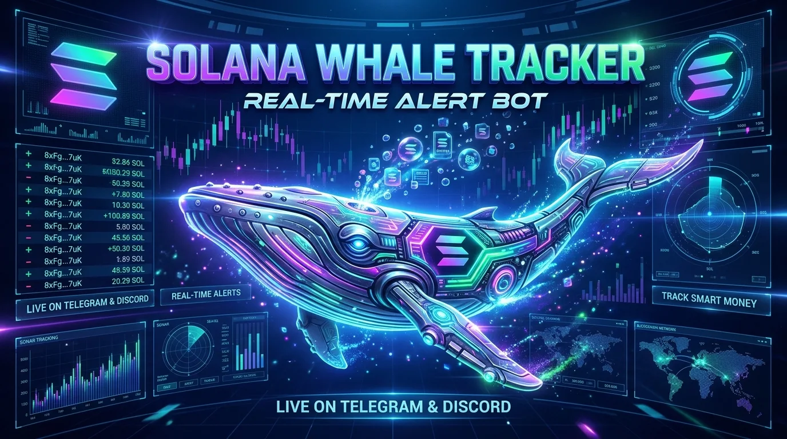

[🇮🇷 فارسی](./README.fa.md)
# 🐋 Solana Whale Tracker Bot



[](https://t.me/Sa_whale_bot)
[](https://www.typescriptlang.org/)
[](https://fastify.dev/)
[](https://solana.com/)

A high-speed, real-time **Solana Mainnet Smart Money & Whale Tracker** built with TypeScript, Fastify, and Helius Enhanced Webhooks. It monitors labeled high-conviction wallets for live `SWAP` events, filters out scams automatically using on-chain authority checks and RugCheck, and delivers instant alerts directly to Telegram.

👉 **Try the live bot on Telegram:** [@Sa_whale_bot](https://t.me/Sa_whale_bot)

---

## ✨ Key Features

- **⚡ Real-Time Swap Detection:** Powered by Helius Enhanced Transaction Webhooks (`SWAP`), acknowledging incoming payloads with an immediate `200 OK` while processing alerts asynchronously.
- **🛡️ Fail-Closed Anti-Scam Engine:** Verifies tokens before alerting:
  - Checks on-chain **Mint Authority** and **Freeze Authority** (must be disabled) via Solana RPC / DAS API.
  - Integrates with the **RugCheck API** to filter high-risk or rugged tokens.
  - Enforces fail-closed logic so unverified or failing API responses never trigger false alerts.
- **🏷️ Custom Whale Labeling:** Map tracked wallet addresses to custom labels via `WHALE_LABELS_JSON` for clean, readable alerts.
- **🔁 Deduplication Cache:** Prevents duplicate Telegram notifications for repeated webhook deliveries or overlapping transaction events.
- **🤖 Extensible Architecture:** Includes modular hooks (`futureHooks.ts`) structured for future Jupiter Swap API auto-buy execution.

---

## 🏗️ Tech Stack

| Layer | Technology |
| :--- | :--- |
| **Runtime & Language** | Node.js, TypeScript |
| **Web Server** | Fastify |
| **Blockchain Data** | Helius Enhanced Webhooks, Solana RPC & DAS API |
| **Security Verification** | RugCheck API + On-chain Authority Checks |
| **Notifications** | Telegram Bot API ([@Sa_whale_bot](https://t.me/Sa_whale_bot)) |
| **Deployment** | Render (Production) / `cloudflared` or `ngrok` (Local Dev) |

---

## ⚙️ Environment Variables

Create a `.env` file in the root directory (or configure these keys in your Render dashboard):

```env
PORT=3000
HELIUS_API_KEY=your_helius_api_key
HELIUS_RPC_URL=[https://mainnet.helius-rpc.com/?api-key=your_helius_api_key](https://mainnet.helius-rpc.com/?api-key=your_helius_api_key)
WEBHOOK_AUTH_HEADER=your_secret_webhook_token
TELEGRAM_BOT_TOKEN=your_telegram_bot_token
TELEGRAM_CHAT_ID=your_telegram_chat_id
WHALE_LABELS_JSON={"WalletAddress1":"Whale Name 1","WalletAddress2":"Smart Money 2"}
```

> Make sure `WEBHOOK_AUTH_HEADER` matches the Authorization Header configured in your Helius Webhook settings, and that `WHALE_LABELS_JSON` is valid single-line JSON.

---

## 🚀 Getting Started

### 1. Clone & Install

```bash
git clone [https://github.com/saeidkhorsandbtc-debug/whale-tracker.git](https://github.com/saeidkhorsandbtc-debug/whale-tracker.git)
cd whale-tracker
npm install
```

### 2. Run Locally

```bash
npm run dev
```

For local webhook testing with Helius, expose your local port using `cloudflared` or `ngrok`:

```bash
cloudflared tunnel --url http://localhost:3000
```

### 3. Build & Production Run

```bash
npm run build
npm start
```

---

## ☁️ Deploying on Render

1. Fork or clone [saeidkhorsandbtc-debug/whale-tracker](https://github.com/saeidkhorsandbtc-debug/whale-tracker).
2. Create a new **Web Service** on [Render](https://render.com/) and connect your repository.
3. Set the commands:
   - **Build Command:** `npm install && npm run build`
   - **Start Command:** `npm start`
4. Add all required keys from `.env` under **Environment Variables**.
5. Copy your live Render URL and configure a **Helius Enhanced Webhook** pointing to:
   ```
   [https://your-service-name.onrender.com/webhook](https://your-service-name.onrender.com/webhook)
   ```
   - **Transaction Types:** `SWAP`
   - **Account Addresses:** Your tracked whale wallet addresses
   - **Auth Header:** Exact value of `WEBHOOK_AUTH_HEADER`

---

## 🧪 Health Check & Testing

Verify the server is live:

```bash
curl [https://your-service-name.onrender.com/health](https://your-service-name.onrender.com/health)
```

---

## 🗺️ Roadmap

- [x] Helius Enhanced `SWAP` webhook ingestion with fast `200 OK` response
- [x] Mint/Freeze authority & RugCheck fail-closed anti-scam filter
- [x] Deduplication cache & custom JSON whale labels
- [x] Telegram real-time alert delivery via [@Sa_whale_bot](https://t.me/Sa_whale_bot)
- [ ] Jupiter API automated copy-trading execution (`futureHooks.ts`)
- [ ] Multi-wallet confluence alerts (alert when 2+ whales buy the same token)

---

## ⚠️ Disclaimer

This tool is built for informational and research purposes only and does not constitute financial advice. Cryptocurrency trading—especially on-chain meme coins—carries significant risk. Always do your own research (DYOR).
